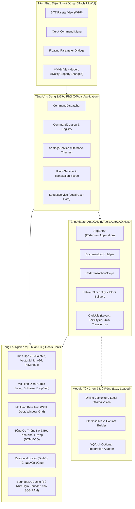

# KIẾN TRÚC TỔNG THỂ DTOOLS PRO (ARCHITECTURE SPECIFICATION)

## 1. Mục Tiêu Thiết Kế
1. **Tính Độc Lập & Module Hóa**: Tách biệt hoàn toàn toán hình học và logic nghiệp vụ khỏi API AutoCAD để có thể kiểm thử tự động (Unit Testable).
2. **Tối Ưu Phần Cứng Laptop 8 GB RAM**: Thiết kế chế độ **Lite Mode** mặc định, hạn chế tiêu thụ bộ nhớ RAM, không rò rỉ bộ nhớ (leak-free), khởi động dưới 300ms.
3. **An Toàn Bản Vẽ Kỹ Thuật**: Giao dịch cơ sở dữ liệu (`Transaction`), DocumentLock chặt chẽ, khôi phục biến hệ thống khi xảy ra ngoại lệ.
4. **Trải Nghiệm Người Dùng (UX) Chuẩn Mực**: Giao diện WPF hiện đại, 100% tiếng Việt có dấu, phím tắt nhanh, hỗ trợ chèn đối tượng liên tục.

---

## 2. Sơ Đồ Khối Kiến Trúc (Architectural Blueprint)

---

## 3. Trách Nhiệm Chi Tiết Của Từng Tầng

### 3.1. DTools.Core (Domain / Core Layer)
- **Đặc điểm**: Biên dịch chuẩn C# (.NET Standard 2.0 / .NET Framework 4.8), **TUYỆT ĐỐI KHÔNG** tham chiếu thư viện Autodesk (`acmgd`, `acdbmgd`) hay thư viện UI (`PresentationFramework`).
- **Nhiệm vụ**:
  - `GeometryMath`: Tính toán khoảng cách, giao điểm, offset đường polyline, tính diện tích đa giác, kiểm tra điểm nằm trong vùng.
  - `ElectricalFormulas`: Công thức tính dòng điện định mức $I = \frac{P}{\sqrt{3} \times U \times \cos\varphi}$, sụt áp $\Delta U$, chọn tiết diện dây dẫn đồng theo bảng tra IEC/TCVN.
  - `RebarFormulas`: Tính chiều dài uốn móc thép 90° ($6d$), 135° ($10d$), trọng lượng thép theo đường kính $W = \frac{d^2}{162}$.
  - `ResourceLocator`: Cơ chế giải quyết đường dẫn tệp tin động (tự động nhận diện thư mục bundle, không hardcode đường dẫn máy lập trình).
  - `BoundedLruCache<TKey, TValue>`: Bộ nhớ đệm tự động giải phóng đối tượng cũ nhất khi đầy danh sách, chặn đứng nguy cơ rò rỉ RAM.

### 3.2. DTools.Application (Application Layer)
- **Nhiệm vụ**:
  - Cung cấp các giao diện tương tác: `ICommandDispatcher`, `ILoggerService`, `ISettingsService`.
  - Quản lý trạng thái ứng dụng: Chế độ `LiteMode` (dành cho máy 8GB RAM), cấu hình lưu trữ tại `%LOCALAPPDATA%\DToolsPro\settings.json`.
  - Định tuyến lệnh AutoCAD an toàn giữa giao diện người dùng và AutoCAD CommandStack.

### 3.3. DTools.AutoCAD.Host (Host Adapter Layer)
- **Nhiệm vụ**:
  - Thực thi giao tiếp trực tiếp với AutoCAD qua `Autodesk.AutoCAD.Runtime.IExtensionApplication`.
  - Quản lý vòng đời `Transaction`, `DocumentLock`, `OpenCloseTransaction`.
  - Đảm bảo tính nhất quán của hệ trục tọa độ `WCS` / `UCS` và đơn vị đo `INSUNITS`.
  - Tự động tạo và kiểm tra các Layer chuyên dụng (`E-SYMBOLS`, `A-WALL`, `A-DOOR`, `S-REBAR`) và TextStyle Unicode chuẩn (`DTT_UNICODE`).

### 3.4. DTools.UI.Wpf (Presentation Layer)
- **Nhiệm vụ**:
  - Xây dựng giao diện Palette trên nền WPF (Windows Presentation Foundation) hiện đại, hỗ trợ Windows High-DPI (100%, 125%, 150%).
  - Bố cục gọn gàng, chia 8 nhóm tính năng có tổ chức khoa học.
  - Ô tìm kiếm trang bị cơ chế **Debounce 200ms**, tránh giật đơ khi người dùng gõ từ khóa tìm kiếm nhanh.
  - Tuyệt đối không sử dụng hiệu ứng đổ bóng GPU (DropShadow/Blur/Shader) nặng nề gây hao tổn GPU/CPU trên laptop.

---

## 4. Quản Lý Luồng & Bất Đồng Bộ (Threading Model)
1. **Nguyên tắc vàng của AutoCAD .NET**: AutoCAD là ứng dụng hướng đơn luồng (Single-Threaded Apartment / Document Thread). Mọi thao tác đọc/ghi cơ sở dữ liệu bản vẽ (`Database`), tương tác con trỏ (`Editor.GetPoint`) **BẮT BUỘC** phải diễn ra trên luồng chính của tài liệu CAD có khóa tài liệu (`DocumentLock`).
2. **Tách biệt tác vụ nặng**:
   - Các phép tính toán thuần túy (tính ma trận hình học, phân tích ảnh, xuất file CSV/Excel lớn) được đưa vào `Task.Run()` để không làm đóng băng giao diện WPF.
   - Khi có kết quả, dữ liệu được chuyển về luồng chính AutoCAD để mở một `Transaction` ngắn gọn và ghi entity vào bản vẽ.
